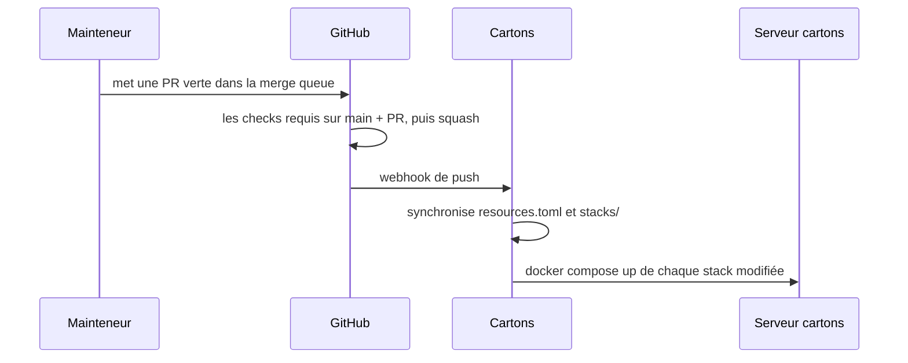
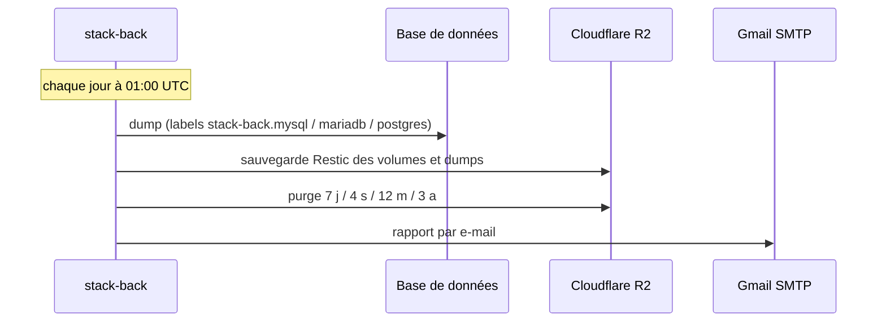

## Déployer un changement

Les checks requis sont ceux du tableau des [concepts transversaux](08-cross-cutting-concepts.md).

Pour LibreTime, Cartons lance d'abord l'étape `pre_deploy` : `envsubst` produit `config.yml` depuis `config.template.yml`, puis `libretime-api migrate` migre la base. LibreTime est redéployé à chaque push, modifié ou non (`webhook_force_deploy`).

### Quand le déploiement échoue

Rien ne revient en arrière tout seul. Si `pre_deploy` échoue, Cartons ne lance pas la stack. Si `docker compose up` échoue, la stack reste dans l'état où l'échec l'a laissée, et Cartons le montre dans son interface. Le mainteneur corrige par une nouvelle PR, ou annule par une PR qui défait le changement : il n'y a pas d'autre chemin vers `main` ([ADR-0001](../../adr/local/ADR-0001-merge-queue.md)).

## Sauvegarder

## Restaurer une stack

Le serveur tourne, et une base ou des fichiers sont à reprendre : suivre [Restaurer une stack depuis une sauvegarde](../../how-to/restaurer-une-sauvegarde.md). Le guide passe par le service `backup` de la stack, qui porte les identifiants Restic et R2.

## Reconstruire après la perte du serveur

Ce scénario n'a jamais été exercé : c'est un plan, pas une procédure éprouvée ([risques](11-risks-and-technical-debt.md)).

Cartons tourne sur le serveur `cartons`. Le perdre, c'est perdre aussi Cartons et les secrets qu'il injecte. Trois choses survivent ailleurs : ce dépôt, sur GitHub ; les sauvegardes, sur R2 ; une copie des secrets, dans le trousseau macOS du mainteneur ([ADR-0015](../../adr/engineering/ADR-0015-secrets.md)). Le volume Hetzner `superlarsen` est distinct du serveur : il survit si seul le serveur est perdu.

1. pastis-hosting remonte un serveur `cartons`, avec Docker, Caddy et Cartons. C'est hors du périmètre de ce dépôt.
2. Le mainteneur applique Terraform, qui rattache le volume au nouveau serveur ([Appliquer Terraform](../../how-to/appliquer-terraform.md)). Si le volume est perdu lui aussi, Terraform en crée un vide.
3. Le mainteneur ressaisit dans Cartons les secrets que `resources.toml` désigne par `[[NOM]]`, depuis son trousseau.
4. Cartons synchronise le dépôt et déploie les stacks.
5. Le mainteneur restaure depuis R2 ce que le volume ne porte pas, avec le guide ci-dessus : la base de BookStack dans tous les cas, puisqu'elle est sur le disque du serveur, et toutes les données si le volume est perdu.

La perte est au plus celle des données écrites depuis la sauvegarde de 01:00 UTC.

## Modifier l'infrastructure

Un changement sous `infrastructure/terraform/` est planifié puis appliqué à la main sur Terraform Cloud, après le merge. Entre le merge et l'application, `main` décrit une infrastructure qui n'existe pas encore.
