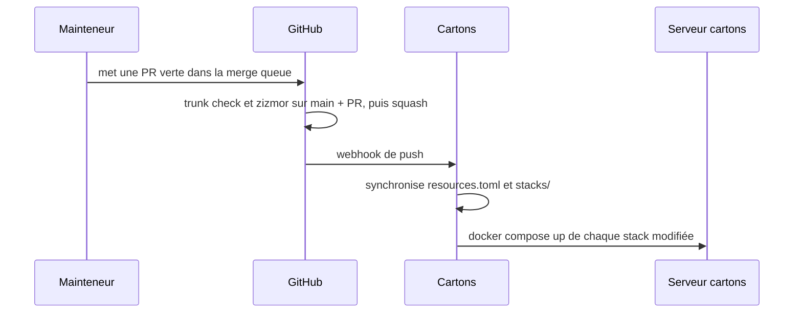

## Déployer un changement

Pour LibreTime, Cartons lance d'abord l'étape `pre_deploy` : `envsubst` produit `config.yml` depuis `config.template.yml`, puis `libretime-api migrate` migre la base.

## Sauvegarder

## Modifier l'infrastructure

Un changement sous `infrastructure/terraform/` est planifié puis appliqué à la main sur Terraform Cloud, après le merge.
